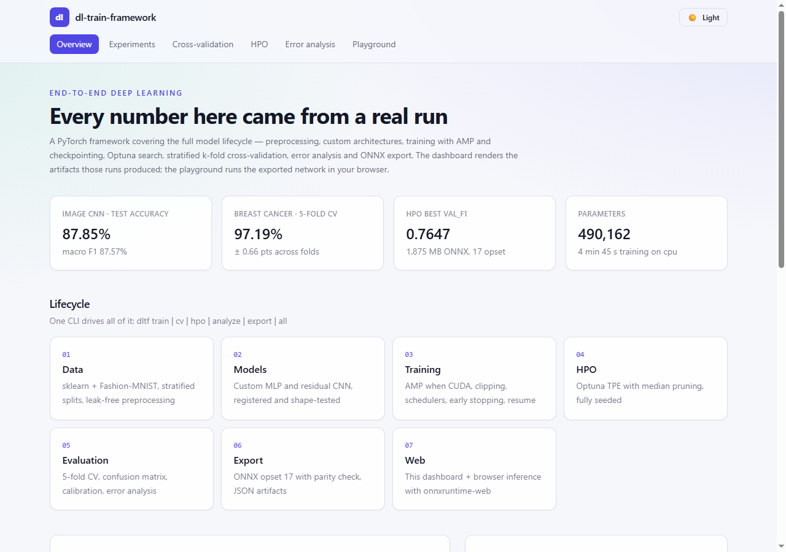
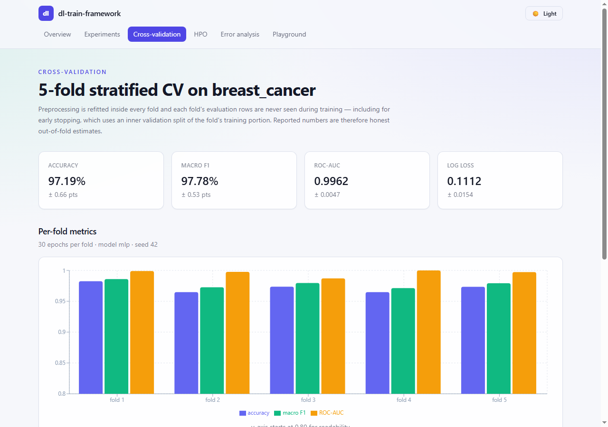
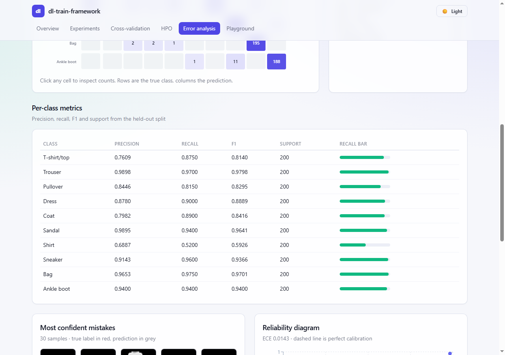
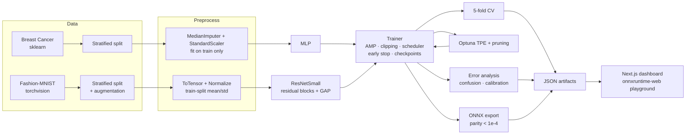
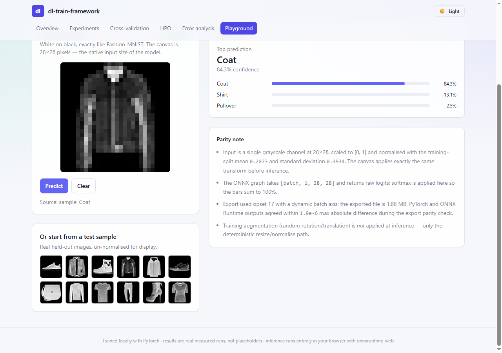
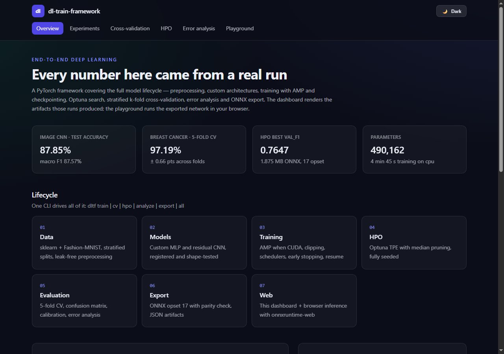

# dl-train-framework

End-to-end deep learning training framework in PyTorch — from raw data to a model
running in a browser. Every number in this README comes from a run that actually
executed on CPU; the JSON artifacts those runs produced are committed under
[`web/public/data/`](web/public/data) and rendered by the Next.js dashboard in
[`web/`](web).

- **Training** — custom MLP and residual CNN, AMP when a GPU is present, gradient
  clipping, three LR schedulers, early stopping, atomic checkpoints, resume with
  exact RNG restoration.
- **Experiments** — stratified splits, leak-free preprocessing, seeded runs, config
  captured with every run, git commit in every checkpoint.
- **Evaluation** — 5-fold stratified cross-validation, Optuna (TPE + median
  pruning) hyper-parameter search, confusion matrices, per-class metrics,
  calibration curves and an auto-generated findings report.
- **Delivery** — ONNX export (opset 17, dynamic batch) with a numerical parity
  check, static JSON artifacts, and a Next.js dashboard whose playground runs the
  exported network locally with `onnxruntime-web` (WASM).

**Live demo:** <https://dl-train-framework.vercel.app> — no sign-in, no server-side
inference; the playground downloads the 1.87 MB ONNX file and runs it with WASM in
your browser.



---

## Results (real, measured on CPU)

### Tabular — Breast Cancer (569 samples, 30 features, binary)

MLP `30 → 64 → 32 → 2`, BatchNorm + dropout 0.2, AdamW, cosine schedule, 40 epochs.
Preprocessing (median imputer + standard scaler) is fitted on the training rows only.

| Metric | Held-out test (86 samples) |
| --- | --- |
| Accuracy | **96.51 %** |
| Macro F1 | **97.20 %** |
| ROC-AUC | **0.9965** |
| Log loss | 0.1061 |

### 5-fold stratified cross-validation (same model, refit per fold)

| Metric | Mean ± std |
| --- | --- |
| Accuracy | **0.9719 ± 0.0066** |
| Macro F1 | **0.9778 ± 0.0053** |
| ROC-AUC | **0.9962 ± 0.0047** |
| Log loss | 0.1112 ± 0.0154 |

### Image — Fashion-MNIST (ResNetSmall, 490,162 parameters)

10,000 train / 2,000 validation / 2,000 test images, 6 epochs, batch 32,
AdamW + OneCycle, random rotation ±10° and translation ±10 % on the training split
only. Hyper-parameters came from the Optuna search below.

| Metric | Held-out test (2,000 samples) |
| --- | --- |
| Accuracy | **87.85 %** |
| Macro F1 | **87.57 %** |
| ROC-AUC (macro OVR) | **0.9883** |
| Log loss | 0.3444 |
| Training time | 4 min 45 s (CPU) |
| ONNX size / opset | 1.87 MB / 17 |
| PyTorch ↔ ONNX max abs diff | **1.9 × 10⁻⁶** |

Error analysis on the same 2,000 held-out images: 243 misclassified (12.15 % error),
expected calibration error **0.0143**, weakest class **Shirt** (recall 0.520), most
frequent confusion **Shirt → T-shirt/top** (48 cases).

### Hyper-parameter search (Optuna TPE + MedianPruner)

8 trials × 3 epochs on a 3,000-image subset: 5 completed, 3 pruned. Best validation
macro F1 **0.7647** (trial 3).

| Parameter | Best value |
| --- | --- |
| `lr` | 0.001082 |
| `weight_decay` | 0.007852 |
| `dropout` | 0.0799 |
| `width` | 24 |
| `batch_size` | 32 |
| `optimizer` | `adamw` |

The winning configuration was applied to the final image run above.

| Cross-validation | Error analysis |
| --- | --- |
|  |  |

---

## Architecture



---

## Install

Requires Python ≥ 3.10 and Node ≥ 18.18.

```bash
git clone <this repo>
cd dl-train-framework
make setup          # .venv + pinned CPU wheels (see requirements.txt)
```

For a CUDA machine use `make setup-cuda` (torch cu124 wheels) instead. The framework
detects the device itself: CUDA → Apple MPS → CPU.
The web app is separate:

```bash
cd web && npm ci
```

---

## Usage

All commands read a YAML config and accept dotted overrides.

```bash
# train the tabular MLP (writes runs/<timestamp>_<name>/)
.venv/bin/dltf train --config configs/tabular_mlp.yaml

# 5-fold stratified cross-validation
.venv/bin/dltf cv --config configs/tabular_mlp.yaml

# Optuna search for the CNN (writes artifacts/hpo_results.json + best params)
.venv/bin/dltf hpo --config configs/hpo_image_cnn.yaml

# train the image CNN, optionally with the HPO best parameters
.venv/bin/dltf train --config configs/image_cnn.yaml \
  --override optim.lr=0.001082 --override model.width=24 --override data.batch_size=32

# error analysis for the latest image run
.venv/bin/dltf analyze --config configs/image_cnn.yaml --task image

# ONNX export + parity check + all web artifacts
.venv/bin/dltf export --config configs/image_cnn.yaml

# the whole pipeline in order
.venv/bin/dltf all
```

`make train | cv | hpo | analyze | export | all` are shortcuts for the above.
Overrides take YAML-parsed values, e.g. `--override model.hidden_sizes=[32,16]`,
`--override train.epochs=3`, `--override data.download=false`.

Training output layout:

```
runs/20261121-075542_image_cnn/
├── config.yaml        # exact config used
├── metrics.csv        # one row per epoch
├── metrics.json       # history + best epoch + summary
├── summary.json       # + test metrics, git hash, device, model size
└── checkpoints/
    ├── best.pt        # best val metric (config, metrics, git hash, RNG state)
    └── last.pt
```

Resume from a checkpoint (model, optimizer, scheduler, AMP scaler, epoch, RNG and
DataLoader order are restored — tested to reproduce an uninterrupted run):

```bash
.venv/bin/dltf train --config configs/image_cnn.yaml --resume runs/<id>/checkpoints/last.pt
```

### Web app

```bash
cd web
npm run dev      # http://localhost:3000
npm run build && npm run start
npm run lint
```

Next.js is pinned to **15.5.7** and React to **19.0.3** — the releases patched for
CVE-2025-66478 / CVE-2025-55182 (Vercel refuses to build vulnerable versions).

Pages: `/` overview · `/experiments` training curves and run comparison ·
`/cross-validation` per-fold metrics · `/hpo` trial history and parameter
importance · `/error-analysis` interactive confusion matrix, gallery, calibration ·
`/playground` draw on a 28×28 canvas (or pick a test sample) and run the ONNX model
in the browser.

### Deploying to Vercel

The app is live at <https://dl-train-framework.vercel.app>. It is a Next.js project
with **Root Directory = `web`**, install command `npm ci` and build command
`npm run build`; there are no environment variables and no server-side secrets.
`public/ort/` is generated by `prebuild`, so the WASM runtime is served from the
same origin as the app.



Dark mode is a first-class theme (class-based Tailwind, respecting
`prefers-color-scheme` and persisted in `localStorage`):



`prebuild` copies the `onnxruntime-web` WASM runtime into `web/public/ort/` so it is
served from the app's own origin (no CDN). The 1.87 MB model lives in
`web/public/models/model.onnx`.

---

## Configuration reference

| Key | Meaning |
| --- | --- |
| `name`, `task` | Run name; `tabular` or `image` |
| `seed` | Global seed for python/numpy/torch/cuda + DataLoader workers |
| `device` | `auto` (default), `cpu`, `cuda`, `mps` |
| `data.name` | `breast_cancer`, `wine` or `fashion_mnist` |
| `data.val_fraction` / `test_fraction` | Stratified split fractions |
| `data.batch_size` / `eval_batch_size` | DataLoader batch sizes |
| `data.subset_train/val/test` | Optional caps for fast CPU runs (`null` = all) |
| `data.augmentation`, `rotation_degrees`, `translate` | Train-only image augmentation |
| `model.name` | `mlp` or `cnn` (registry in `src/dltf/models/registry.py`) |
| `model.hidden_sizes`, `activation`, `batchnorm`, `dropout` | MLP architecture |
| `model.width`, `depth` | CNN base width and residual blocks per stage |
| `optim.optimizer`, `lr`, `weight_decay`, `momentum` | Optimizer |
| `optim.scheduler` | `none`, `cosine`, `onecycle`, `plateau` |
| `optim.grad_clip` | Gradient-norm clipping (`null` disables) |
| `train.epochs`, `amp`, `deterministic` | Loop settings (AMP only activates on CUDA) |
| `train.early_stopping_patience`, `monitor` | Early stopping (`val_loss`, `val_f1`, …) |
| `hpo.*` | Trials, metric, subsets, epochs, search space |
| `cv.n_splits`, `epochs` | Cross-validation settings |
| `paths.*` | `runs/`, `data/`, `artifacts/`, web output dirs |

---

## Reproducibility

- `set_seed` seeds Python, NumPy, PyTorch (CPU + all CUDA devices), cuDNN
  determinism, `PYTHONHASHSEED`, and the `CUBLAS_WORKSPACE_CONFIG` workaround.
- Every DataLoader shuffles with a seeded `torch.Generator`; workers get a
  `worker_init_fn` derived from it.
- Checkpoints store the RNG state of Python/NumPy/Torch **and** the loader
  generator, so resuming continues the identical sample order. `pytest` asserts a
  2 + 2 epoch resume matches a 4 epoch run to 1e-6.
- The Optuna sampler is seeded, and each trial is seeded with `seed + trial.number`.
- Each run records its full config, git commit, device, library versions and split
  sizes; `dltf export` copies the config into the model card.

Measured on this machine (2 vCPU, no GPU): tabular training ~4 s, 5-fold CV ~8 s,
HPO ~4.5 min, image training ~4.75 min — comfortably inside the 15-minute CPU budget.

## GPU notes

- `get_device("auto")` returns CUDA when available, then Apple MPS, then CPU.
- AMP (`torch.autocast` + `GradScaler`) is enabled **only** on CUDA; MPS and CPU run
  in fp32 and the checkpoint/artifacts record which path was used.
- Requesting an unavailable device raises instead of silently falling back.
- This repository's committed results were produced on CPU (no GPU in the build
  environment), which is why the image run uses subsets.

## Testing and CI

```bash
make test    # 43 tests, ~15 s
make lint    # ruff
```

Coverage includes seed determinism, stratified splits and a leakage proof, model
shapes and finite gradients, overfitting a 32-sample batch to 100 %, checkpoint
round-trip and resume parity, CV fold disjointness, an Optuna smoke search, metric
math, error-analysis artifacts and ONNX parity (including dynamic batch).

GitHub Actions (`.github/workflows/ci.yml`) runs `ruff`, `pytest` and the web
`lint` + `build` on every push and pull request.

---

## Limitations

- Demo experiments use subsets of Fashion-MNIST (10k train) to stay inside a
  CPU time budget; 87.85 % is respectable for 6 epochs but far from
  state-of-the-art (~93 %+ with longer training on the full set).
- No distributed training, mixed-precision on MPS, or transformer architectures.
- Tabular cross-validation is implemented for the sklearn datasets shipped with
  the repo; arbitrary CSV ingestion would need a small adapter.
- The playground accepts 28×28 grayscale drawings only — the model's native input.
- Web artifacts are static JSON regenerated by `dltf export`; there is no database.

## Project structure

```
configs/                 YAML experiments (tabular, image, HPO)
src/dltf/
  config.py              typed config + dotted CLI overrides
  seed.py  device.py     reproducibility and device/AMP detection
  data/                  splits, tabular pipeline+EDA, Fashion-MNIST loaders
  models/                MLP, residual CNN, registry
  training/              Trainer, checkpoints, metrics, callbacks
  hpo/search.py          Optuna TPE + median pruning
  evaluation/            k-fold CV, error analysis
  export/                ONNX export + parity, web artifacts
  cli.py                 dltf train|cv|hpo|analyze|export|all
tests/                   43 pytest tests
scripts/                 EDA notebook generator (executes its own cells)
notebooks/eda.ipynb      generated, runs cleanly
web/                     Next.js 15 + TypeScript + Tailwind + recharts
.github/workflows/ci.yml lint + tests + web build
```

## License

MIT — see [LICENSE](LICENSE).
